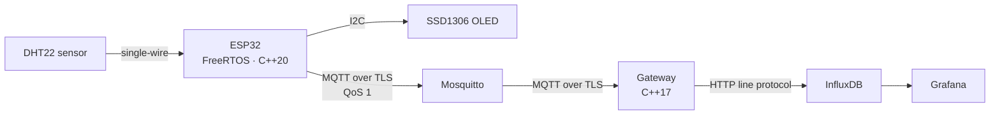

# Agro Telemetry

An end-to-end agricultural telemetry pipeline, built to learn embedded and IoT engineering properly: an ESP32 running FreeRTOS with C++20 firmware reads a temperature/humidity sensor and publishes over MQTT with TLS, a C++17 gateway validates each reading and stores it in InfluxDB, and Grafana shows it on a provisioned dashboard.



Everything to the right of the ESP32 runs on one machine with Docker Compose. The status is honest: this is a bench prototype with three nodes powered over USB, not a field deployment.

> Code comments, log messages and commit messages are in Spanish; this README is in English.

## Repository layout

| Folder | What it is |
|---|---|
| [`firmware/`](firmware/) | ESP-IDF 6 project for an ESP32 DevKit V1: FreeRTOS tasks in C++20 |
| [`gateway/`](gateway/) | C++17 service: MQTT subscriber → validation → InfluxDB writer, with unit tests |
| [`infrastructure/`](infrastructure/) | Docker Compose stack: Mosquitto, InfluxDB, gateway, Grafana |

## How it works

### Firmware (ESP32, FreeRTOS, C++20)

Three application tasks, all at priority 5 on a dual-core ESP32, communicating only through FreeRTOS queues that copy data by value — no shared memory, no mutexes:

- **Identity from the MAC address.** Every board runs the same binary. At boot it reads its factory MAC from eFuse and names itself `esp32-` plus the last three bytes (for example `esp32-1e1574`). That ID is its MQTT client ID, part of its topic and the `device_id` in each payload, so a new board shows up in Grafana with no per-board configuration.
- **`SensorTask`** reads the DHT22 every 2 s with `vTaskDelayUntil()` so the period does not drift, and pushes each reading into a 5-slot queue. If the queue is full it drops the new sample and logs it, rather than blocking the sampling loop.
- **`TelemetryTask`** takes readings from that queue, logs them, hands them to the MQTT client and draws them on the OLED.
- **`MqttClient`** owns its own task, which is the *only* code that touches the ESP-MQTT client and its connection state. Network events (from the ESP-IDF event loop), MQTT events (from ESP-MQTT's internal task) and publish requests all arrive as messages on one queue and are processed in order, so no decision — such as starting the transport — can be taken from two tasks at once.

Health and robustness:

- **Task watchdog:** `SensorTask`, `TelemetryTask` and the MQTT task subscribe to the ESP-IDF task watchdog. If one stops feeding it for 5 s, the board prints a backtrace and reboots. A `static_assert` in each task requires its period or queue wait to be under half the timeout, so changing a period breaks the build, not the board.
- **`TaskMonitor`** logs every task in the system (including the ones ESP-IDF creates) every 30 s, sorted by minimum free stack, plus free heap. Stack sizes are backed by measurements from it.
- **DHT22 driver** is bit-banged on one GPIO in open-drain mode, so the line can be released and read without reconfiguring the pin in the timing-critical window. Full checksum validation; temperature decoded as sign-and-magnitude.
- **TLS:** the broker's CA certificate is embedded in the binary; the client verifies the broker and authenticates with username and password. Publishing never blocks the caller while disconnected.

### Gateway (C++17)

Two threads and a bounded queue:

- The MQTT thread (Paho C++, TLS) subscribes to `agro/devices/+/telemetry` with QoS 1, parses and validates each JSON message and enqueues it. It never touches InfluxDB. The node's identity comes from the topic, which the broker's ACL guarantees, not from the payload: a message whose `device_id` does not match its topic is rejected.
- A persistence thread drains the queue in batches, serializes them to InfluxDB line protocol and writes them over HTTP, with exponential backoff on 429/5xx/network errors. Permanent errors (400/401/403) are logged and dropped instead of retried forever.
- The queue holds 1000 readings. When full it drops the **oldest** reading instead of blocking the MQTT thread.
- Unit tests for the parser, the queue and the serializer run inside the multi-stage Docker build: a failing test means no image.

### Infrastructure (Docker Compose)

- **Mosquitto** on port 8883, TLS only, no anonymous access. An ACL denies everything not listed: each node may only publish to the topic carrying its own client ID (`pattern write agro/devices/%c/telemetry`), and the gateway may only read telemetry.
- **InfluxDB 2** with organization `agro-telemetry`, bucket `telemetry`, 720 h retention.
- **Grafana** with the data source and dashboard provisioned from files; it reads with a token scoped read-only to the telemetry bucket. The dashboard discovers nodes from InfluxDB, shows all of them by default with one line per node plus a per-node status table (latest values, Wi-Fi signal and time since the last message) and a Wi-Fi signal graph, and can show a friendly name per node: edit the hidden `aliases` variable in `infrastructure/grafana/dashboards/agro-telemetry.json` (`esp32-1e1574=Desk,esp32-5de31c=Window`), and Grafana reloads it within 10 s.
- **Secrets** are individual files mounted as Docker secrets under `/run/secrets/` — never plain environment variables, never baked into an image. Private keys and the Mosquitto password file are git-ignored.

### AWS IoT Core (experiment)

A node can publish to AWS IoT Core instead of the local broker: a Kconfig choice (*Agro Telemetry → MQTT broker*) switches only how the client authenticates. The topic, the JSON and the MQTT task stay the same.

- **Mutual TLS with a certificate per device.** Each node is an IoT *thing* named after its device ID, with its own X.509 certificate. The node verifies AWS with Amazon Root CA 1; AWS identifies the node by its certificate.
- **The policy mirrors the Mosquitto ACL, but is stronger.** It allows `iot:Connect` only as `client/${iot:Connection.Thing.ThingName}` and `iot:Publish` only to `agro/devices/${iot:Connection.Thing.ThingName}/telemetry`. That variable only resolves when the client ID is a thing that owns the presenting certificate, so a node cannot connect as another one, which the shared Mosquitto password allows. The policy lives in `infrastructure/aws/node-policy.json` and is applied with `aws iot create-policy-version --policy-name agro-node --policy-document file://node-policy.json --set-as-default`. Its ARNs use `*` for region and account: an IoT policy only applies in its own account and region anyway, and it keeps the account ID out of the repo. Listing every shadow and Jobs topic one by one went over AWS's 2048-character limit for a policy, so Subscribe and Receive use `shadow/get/*`, `shadow/update/*` and `jobs/*`, always under `$aws/things/<own thing>/`: a node still cannot reach anything of another node.
- **Tested** from a PC with `mosquitto_pub` before touching the firmware: publishing to another node's topic is rejected (PUBACK 135) and connecting with another node's client ID is refused (CONNACK 135). Then on the board: the living-room node publishes to AWS, with 170 KB of heap free and no change in the MQTT task's stack.
- **Build:** the AWS variant has its own sdkconfig and build folder, so the other nodes' build is untouched: `idf.py -B build-aws -D SDKCONFIG=sdkconfig.aws flash monitor`. The AWS image is the same for every board: each board's certificate and key live in its own `certs` flash partition, written once with `python tools/aws_identity.py <folder with device.crt and device.key> --port <PORT>`. That partition is separate from `nvs` because the Wi-Fi code erases `nvs` when it finds an old version, and a board's identity must not go with it. Without it, the node logs what is missing and does not publish.
- **Storage in DynamoDB.** `infrastructure/aws/telemetry-storage.yaml` is a CloudFormation stack: an IoT rule writes each message to the `agro-telemetry` table, with `device_id` as partition key and arrival time (ms) as sort key. As in the gateway, the identity comes from the topic (`topic(3)`) and a payload claiming another device is dropped; fields are listed one by one instead of `SELECT *`. Rows expire through TTL after `RetentionDays` (7 by default), rule errors go to CloudWatch Logs, and the rule's IAM role can only `PutItem` on that table and can only be assumed by IoT for this account and this rule. Tested with the living-room node: a row every 2 s, with `expires_at` exactly 7 days after arrival. Deleting the stack removes all of it.
- **Device Shadow: how often to send, set from the cloud.** The shadow's `desired.telemetry_interval_s` (an integer from 2 to 3600, 2 by default) sets how often the node sends a reading to AWS. The sensor still reads every 2 s and the OLED shows every reading; only what goes to the cloud thins out, so `sequence` in DynamoDB jumps by `interval / 2`. On every connection the node subscribes to its shadow topics with a single SUBSCRIBE, requests the document (`get`) once the SUBACK arrives, applies `desired` and reports it back in `reported`. Later changes arrive as `update/delta`. An invalid value is neither applied nor reported, so the delta stays visible. Tested on the living-room node: the first boot got a 404 (no shadow yet) and reported 2; a change to 30 was applied and reported within 2 s; a 1 was rejected and left the delta in place without a report loop; after a reset, the node picked up 30 from `get` 8.4 s after boot, without anyone touching the console. Until that document arrives, a reading or two go out at the default interval. The shadow logic costs about 600 B of the MQTT task's stack (1120 B still free).
- **Over-the-air updates with IoT Jobs.** `python tools/ota_release.py <.bin> --thing <ID> --bucket <BucketName> --role-arn <SigningRoleArn>` reads the version and the SHA-256 the build appends to the image, uploads it to a private S3 bucket and creates a Job. `infrastructure/aws/firmware-updates.yaml` holds the bucket, the role IoT uses to presign the download URL (it can only read `firmware/*`), and the `agro-iot-cli` user that may upload and create Jobs (`iam:PassRole` only for that role, only towards IoT). On the node, `MqttClient` handles the Jobs topics like the shadow ones and hands a validated Job to `OtaUpdater`, its own task, because downloading ~1 MB over HTTPS takes about a minute and the MQTT task must keep running. `OtaUpdater` checks the image header's version against the Job before downloading the rest, lets `esp_https_ota` validate the image, compares its SHA-256 with the Job's and reboots. The new image boots on probation: it confirms itself only when it reaches the broker, and if it reboots first, or does not reach the broker within 5 minutes, the bootloader goes back to the previous one. The new image reports `SUCCEEDED`; the old one, after a rollback, reports `FAILED` (`rolled_back`) instead of downloading the failed version again. Rollback is a bootloader option, so each board gets it once over USB. Tested on the living-room node: updates in both directions between the two OTA partitions (about 70 s at ~15 KB/s, telemetry still flowing), a power cut during the new image's first boot rolled back to the previous one with the Job marked `FAILED`, and the current firmware itself was delivered over the air. `OtaUpdater` peaked at ~4.4 KB of stack with the TLS handshake to S3 and runs with 6 KB.

The local stack stays the main system; AWS is a learning experiment on a free-plan account, not something left running.

### C++ standards

Each part declares its standard explicitly in its build, instead of inheriting a toolchain default:

| Part | Standard | Why |
|---|---|---|
| Firmware | C++20 (`gnu++20`) | The lowest standard the code needs: it uses designated initializers. ESP-IDF 6 would default to `gnu++26`, which would make the build depend on the installed ESP-IDF version. |
| Gateway | C++17 | Nothing in the code needs more. |

A part moves to a newer standard when a feature pays for itself, not to look modern. The candidates already identified are `std::expected` (C++23), so drivers return a value or an error instead of an error code plus an output parameter, and `std::jthread` with `std::stop_token` (C++20), for the gateway's persistence thread shutdown. `std::format` and exceptions stay out of the firmware because of their code size.

### Data contract

The same value changes name between layers on purpose, following each layer's conventions:

| Layer | Humidity field |
|---|---|
| Firmware queue (C++ struct) | `humidity_percent` |
| MQTT payload (JSON) | `humidity_pct` |
| Gateway (C++ struct) | `humidityPct` |
| InfluxDB (line protocol field) | `humidity_pct` |

Example payload on `agro/devices/esp32-1e1574/telemetry`:

```json
{"device_id":"esp32-1e1574","sequence":14,"temperature_c":24.5,"humidity_pct":45.7,"uptime_ms":29367,"rssi_dbm":-61}
```

`rssi_dbm` is the Wi-Fi signal the node sees when it publishes. It is read by the MQTT task at send time, not by the sensor task, because it describes the network rather than the measurement. It is optional, so nodes on older firmware are still accepted, and Grafana graphs it per node to tell a weak signal apart from a power problem.

The gateway rejects a message unless `device_id` is non-empty, `temperature_c` is finite, `humidity_pct` is within 0–100 and, when present, `rssi_dbm` is an integer from −127 to −1. Sequence gaps are logged as warnings, since a lost packet or a reboot explains them.

## Hardware

| Module | Module pin | ESP32 DevKit V1 pin |
|---|---|---|
| DHT22 (3-pin module with pull-up) | VCC / DATA / GND | 3V3 / D4 / GND |
| SSD1306 OLED 128×64 (I2C, 0x3C) | VCC / GND / SCL / SDA | 3V3 / GND / D22 / D21 |

Power the DHT22 from 3.3 V: the module's pull-up goes to VCC and the ESP32 pins are not 5 V tolerant. Mount it away from the board, which heats it.

## Running it

Prerequisites: Docker with Compose, [ESP-IDF v6.0.2](https://docs.espressif.com/projects/esp-idf/en/stable/esp32/get-started/index.html), OpenSSL.

**1. Certificates.** The certificates in the repository were issued for my LAN, so generate your own in `infrastructure/mosquitto/certs/`. The server certificate needs a SAN for `mosquitto` (used by the gateway inside Docker) and for the LAN IP of the machine running the broker (used by the ESP32):

```sh
openssl req -x509 -newkey rsa:2048 -nodes -days 3650 \
  -keyout ca.key -out ca.crt -subj "/CN=Agro Telemetry Local CA"
openssl req -newkey rsa:2048 -nodes -keyout server.key -out server.csr -subj "/CN=mosquitto"
openssl x509 -req -in server.csr -CA ca.crt -CAkey ca.key -CAcreateserial -days 825 \
  -out server.crt -extfile <(printf "subjectAltName=DNS:mosquitto,DNS:localhost,IP:127.0.0.1,IP:<your-LAN-IP>")
```

Copy `ca.crt` to `firmware/main/certs/mqtt_ca.pem`.

**2. MQTT users.** Create `infrastructure/mosquitto/config/passwd` with two users, `agro-node` and `agro-gateway`, using `mosquitto_passwd`. `agro-node` is the fleet user every node logs in with: nodes are told apart by their client ID, and the ACL in `infrastructure/mosquitto/config/acl` keeps each one on its own topic. The container's `mosquitto` user must be able to read the file. If it can't, Mosquitto exits and the reason appears only in `infrastructure/mosquitto/log/mosquitto.log`, not in `docker logs`.

**3. Secrets.** Create the files listed in [`infrastructure/secrets/README.md`](infrastructure/secrets/README.md), plus `mqtt-gateway-password.txt` with the gateway's MQTT password.

**4. Stack.**

```sh
cd infrastructure
docker compose up -d --build
docker compose logs -f gateway
```

Grafana is at http://localhost:3000.

**5. Firmware.** See [`firmware/README.md`](firmware/README.md). In short: set the Wi-Fi network, broker URI and the shared MQTT user and password in `idf.py menuconfig` under *Agro Telemetry*, then run `idf.py -p <PORT> flash monitor` on each board. The same build works for every node.

**Gateway tests** without Docker:

```sh
cd gateway
cmake -S . -B build -DBUILD_TESTING=ON
cmake --build build
ctest --test-dir build --output-on-failure
```

## Known limitations

- Three nodes, on the bench, powered over USB.
- One node has gone silent twice, for 2.5 h and 10 min, without rebooting and without reaching the broker, and came back only after a power cycle; the reset button did not help. The other two nodes, on the same firmware, had no gaps. Not yet diagnosed: the power supply and the Wi-Fi signal where it is placed are the main suspects.
- All nodes share one MQTT user and password. The ACL keeps each client ID on its own topic, but anyone holding the shared password can connect with another node's client ID and publish as that node. Per-node client certificates (mutual TLS) would close this.
- On the local broker, TLS is server-side only: the broker is verified, clients authenticate with passwords. Only the AWS variant uses client certificates.
- Without flash encryption, a board's AWS private key can be read from its `certs` partition by anyone with the board in hand. If that happens, the certificate is revoked in AWS and only that board is affected.
- Readings taken while the broker is unreachable are dropped, not buffered. Only messages that ESP-MQTT has already accepted are retried under QoS 1.
- InfluxDB keeps 30 days of data.
- OTA images are not signed: the node trusts whoever can create Jobs in the account, and the SHA-256 in the Job only proves the image is the one that operator chose. Secure Boot or signed images would remove that trust.

## What's next

Planned, not built:
- A second I2C sensor on the bus the OLED already uses.
